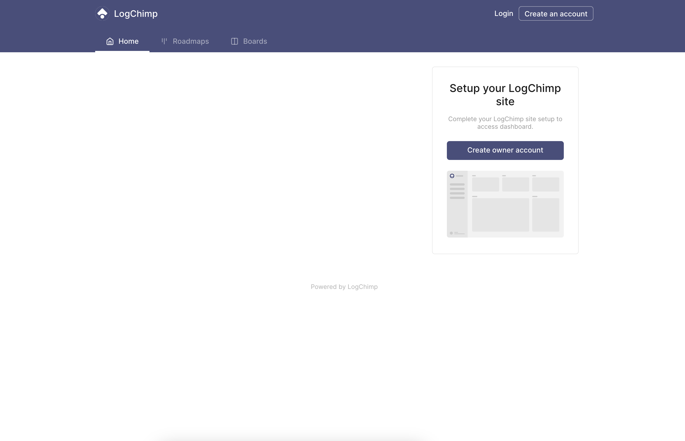

import {Card, Cards} from 'fumadocs-ui/components/card'
import {Step, Steps} from 'fumadocs-ui/components/steps';
import {BracesIcon, KeyRound, MapIcon, PlaneTakeoff} from 'lucide-react';

There are many ways to [install LogChimp Self-Managed](/self-hosting/installation). With Render, you can get started with just a few easy steps. Click the Deploy button, review the services, and hit deploy. It's that simple.

## Prerequisites

You need a Render account.

<Steps>
	<Step>
		## 1. Sending emails

		You will need to set-up SMTP configuration to let your users get emails to reset password, and account verification.

		You can read more about [SMTP for Emails](/self-hosting/smtp-for-email).
	</Step>
	<Step>
		## 2. Deploy LogChimp

		Clicking the "Deploy to Render" button will redirect you to the Render blueprint confirmation page.

		
	</Step>
	<Step>
		## 3. Configure the variables

		The configuration page will display all the services which will be deployed as a part of LogChimp to fully function.

		<Alert type="tip">
			Render automatically provisions the secure secret keys for the required variables.
		</Alert>

		If you want to add or change existing environment variable for each service, this would be the place before all the services are deployed on Render.
		To learn more about them, see [environment variables](/self-hosting/environment-variables).

		Enter the following environment variables by clicking on the "Configure" button next to "LogChimp API" service.
		- [LogChimp license key](/self-hosting/license) - To unlock paid features
		- [SMTP email variables](/self-hosting/smtp-for-email) - see **Step 1: Sending emails**
	</Step>
	<Step>
		## 4. Ready to deploy?

		Click the "apply" button, 🎉 Voilà! You should be able to access LogChimp at `http://localhost:3000`.

		Your LogChimp site is ready to accept **your customers' feedback** with ease.

		
	</Step>
</Steps>

## Unlock more features

Paid plans add features such as [Boards](/guide/boards) and [Roadmaps](/guide/roadmaps). To compare options, see the [paid plans](https://logchimp.app?ref=logchimp-docs).

To unlock these features, [activate your license key](/self-hosting/license).

## Next Steps

Congrats on successfully installing LogChimp.

Phew! That was a lot of work! Let's move to next step.

<Cards>
	<Card
		icon={<KeyRound/>}
		href="/"
		title="Unlock more features"
	>
		Unlock more features by purchasing the license key for LogChimp Self-Managed.
	</Card>
	<Card
		icon={<PlaneTakeoff />}
		href="/platform/setup"
		title="Onboarding setup"
	>
		Setting up your LogChimp site, by creating an owner account.
	</Card>

	<Card
		icon={<MapIcon />}
		href="/guide"
		title="Learn LogChimp"
	>
		Learn how to use LogChimp.
	</Card>

	<Card icon={<BracesIcon />} title="API Reference" href="/api-reference">
		Connect your application with LogChimp.
	</Card>
</Cards>
